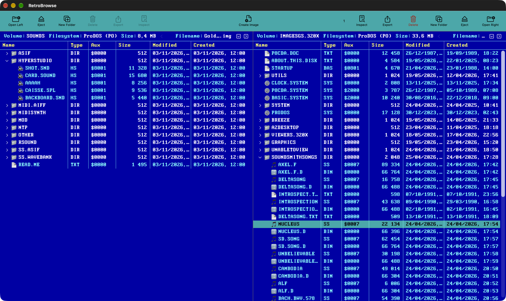
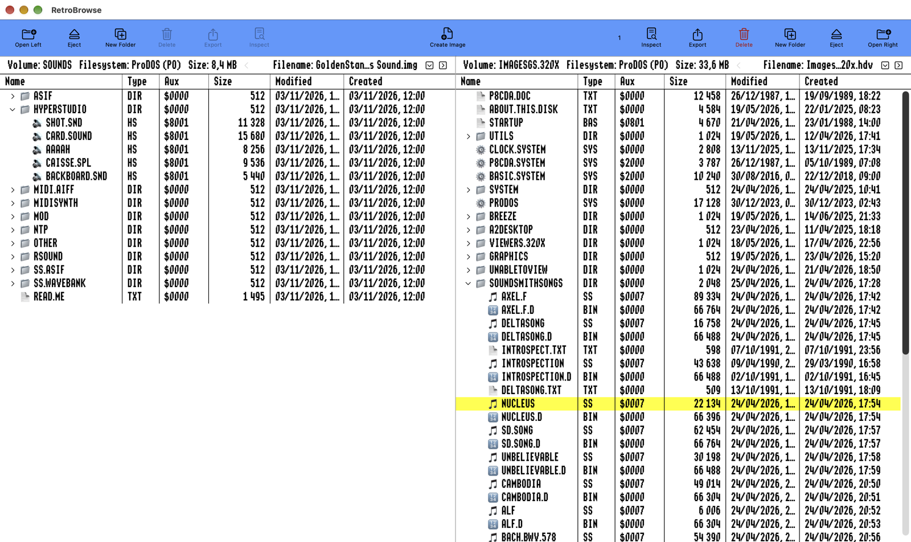

# RetroBrowse

**Always back up your disk images before using RetroBrowse!**

---


## What is RetroBrowse?

RetroBrowse is a modern macOS dual-pane file manager for Apple II disk images, bringing vintage computing into the 21st century.

### Features

- **Dual-Pane Browser** - Work with two disk images simultaneously
- **File Inspector** - View file contents with Space, Cmd+I or the context menu; Space again closes it, like Quick Look
- **Preview Pane** - Turn the other pane into a live preview of the selected file: content, all directory fields, resource forks, editable file and aux type, and editable MOD song and sample texts
- **Native ProDOS Support** - Read and write ProDOS disk images natively in Swift
- **DOS 3.3 Support** - Full read and write support for DOS 3.3 disk images
- **UCSD Pascal Support** - Read UCSD Pascal volumes (read-only)
- **WOZ Disk Images** - Read Applesauce .woz bit images (read-only), with their title and publisher
- **ShrinkIt Archives** - Browse and extract NuFX archives (.shk, .sdk, .bxy)
- **Binary II Archives** - Browse and extract Binary II archives (.bny, .bqy)
- **Drag & Drop** - Copy files between disk images or import from Finder
- **Change File Type** - Right-click to modify file type and aux type
- **Complete File Type Database** - Recognizes 200+ ProDOS file types with proper names
- **Graphics Preview** - View Apple II graphics (HGR, DHGR, SHR, APF) directly
- **Font Preview** - Apple IIgs fonts and Apple II hi-res screen fonts
- **Icon Preview** - Apple IIgs Finder icons with 16-color palette and transparency
- **BASIC Viewer** - Syntax-highlighted Applesoft and Integer BASIC listings
- **Merlin Viewer** - 6502 assembler source with syntax highlighting
- **Disassembler** - 6502 and 65816 machine code disassembly
- **AppleWorks Viewer** - Classic and GS word processor, database, and spreadsheet
- **Teach Viewer** - Apple IIgs Teach documents with fonts, styles, and colors
- **Sound & Music Player** - SoundSmith, NinjaTracker Plus, ProTracker MOD, rSound, HyperStudio, ASIF, AIFF and MIDI play as soon as they are opened
- **Expand / Collapse All** - Open or close every folder in a pane at once
- **Quick Look in the Finder** - Press Space on a disk image or archive in the Finder to see its volume and every file; disk images get floppy, 3.5" and hard disk icons labelled with the volume name
- **Sortable Columns** - Click Name, Type, Size or Modified to sort; click again to reverse, a third time for the order on the disk
- **Skins** - System, Light, Dark, Norton Commander or Apple IIGS 640 (RetroBrowse > Settings)
- **Date/Time Support** - Displays creation and modification dates from ProDOS
- **Modern UI** - Clean SwiftUI interface with resizable columns
- **Export Capability** - Extract files to your Mac  

### Skins

**Norton Commander** — blue panes, cyan files, white folders and the Modern DOS 9x16 font.



**Apple IIGS 640** — the GS/OS Finder look: Shaston 640, black on white and the yellow highlight.



Fonts: Shaston 640 by [Kreative Software](https://www.kreativekorp.com/software/fonts/apple2/) (Relay Fonts Free Use License); Modern DOS 9x16 is public domain (CC0).

### Supported Disk Image Formats

| Format | Extension | Read | Write |
|--------|-----------|------|-------|
| ProDOS Order | `.po` | ✅ | ✅ |
| DOS Order | `.do` | ✅ | ✅ |
| Universal 2IMG | `.2mg` | ✅ | ✅ |
| Hard Disk Volume | `.hdv` | ✅ | ✅ |
| Raw image / DiskCopy 4.2 | `.img` | ✅ | ✅* |
| Generic DSK | `.dsk` | ✅ | ✅ |
| UCSD Pascal Volume | `.vol` | ✅ | ❌ |
| WOZ (5.25" and 3.5") | `.woz` | ✅ | ❌ |

\* Only plain `.img` images are writable; DiskCopy 4.2 images open read-only.

### Supported Archive Formats

| Format | Extension | Read | Write | Description |
|--------|-----------|------|-------|-------------|
| ShrinkIt Disk | `.sdk` | ✅ | ❌ | Compressed disk images |
| ShrinkIt Archive | `.shk` | ✅ | ❌ | Compressed file archives |
| Binary II + ShrinkIt | `.bxy` | ✅ | ❌ | Binary II wrapped ShrinkIt |
| Binary II | `.bny`, `.bqy` | ✅ | ❌ | Binary II archives |
| Gzip | `.gz` | ✅ | ❌ | Gzip compressed files |
| ZIP | `.zip` | ✅ | ❌ | ZIP archives |

*All archive formats are handled natively - no external tools required.*

### Supported File Systems

| File System | Read | Write | Notes |
|-------------|------|-------|-------|
| ProDOS | ✅ | ✅ | Full support including subdirectories |
| DOS 3.3 | ✅ | ✅ | Full support |
| UCSD Pascal | ✅ | ❌ | Read-only |
| ShrinkIt Archives | ✅ | ❌ | Native LZW decompression |
| Binary II Archives | ✅ | ❌ | Read-only |


### Requirements

- macOS 15.7 or later
- Apple Silicon or Intel Mac

### Current Limitations

- UCSD Pascal volumes are read-only
- WOZ images are read-only. Standard 5.25" disks read fully; copy-protected disks open as far as their sectors can be read; 13-sector DOS 3.2 disks can't be opened yet
- ShrinkIt, Binary II, Gzip and ZIP archives are read-only; copy files to a disk image to change them
- If another app (such as Virtual ][) also has a Quick Look preview for disk images, macOS uses one of them; turn the other off in System Settings under Quick Look extensions
- Beta quality - expect bugs!

---

## Quick Start

1. Open two disk images (left and right panes)
2. Browse files with full directory support
3. Press **Cmd+I** to inspect any file (view BASIC listings, graphics, hex dump)
4. Drag & drop files between images
5. Export files to your Mac
6. View Apple II graphics inline

## Building

Requires Xcode 16+ and macOS 15.7+

```bash
open ProBrowse.xcodeproj
```

---

## Development

Built with Swift and SwiftUI for modern macOS.

**License**: MIT

**Status**: Active development - contributions welcome!

---

**Remember: Always backup your disk images before using beta software!**

[](https://github.com/portwally/RetroBrowse/releases)
[](https://github.com/portwally/RetroBrowse/stargazers)
[](https://github.com/portwally/RetroBrowse/network/members)
